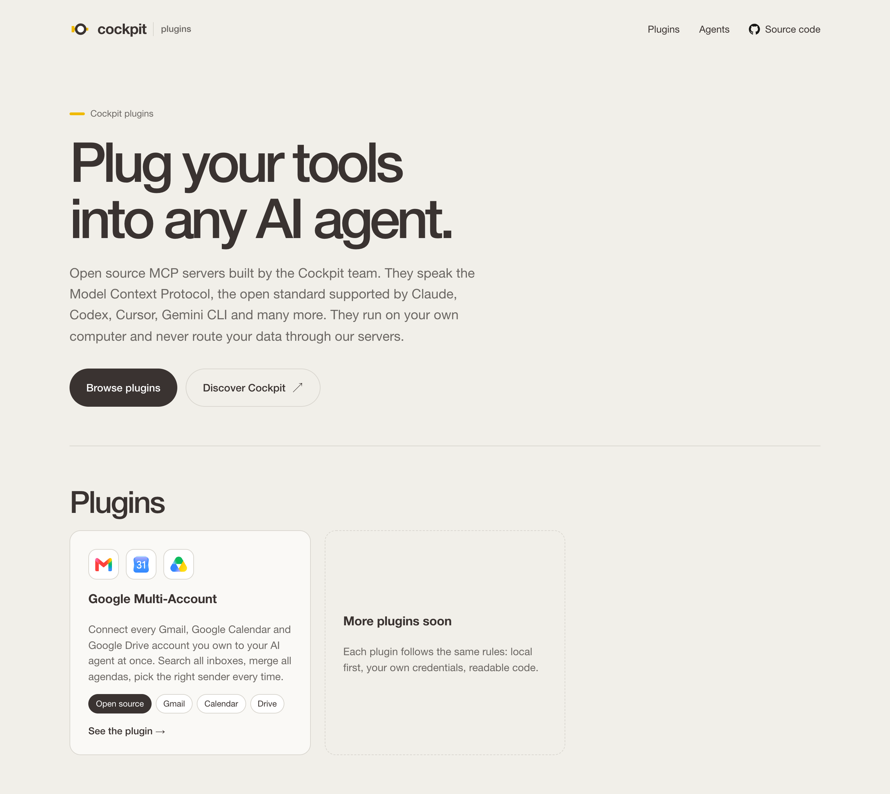
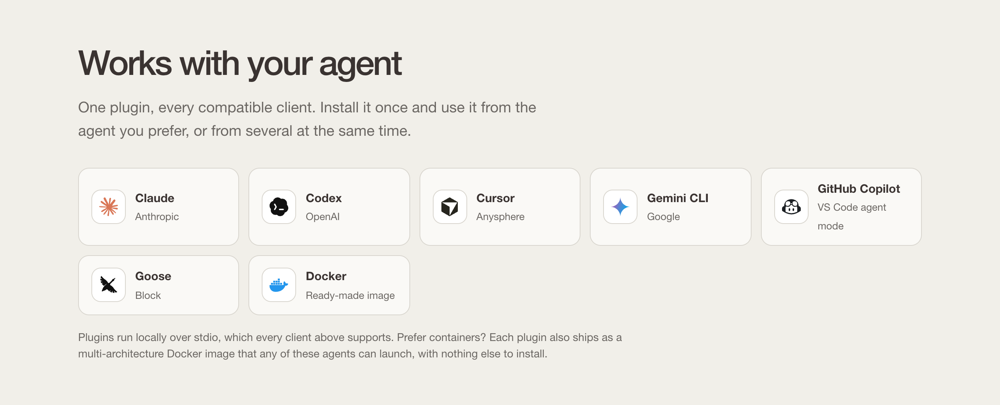
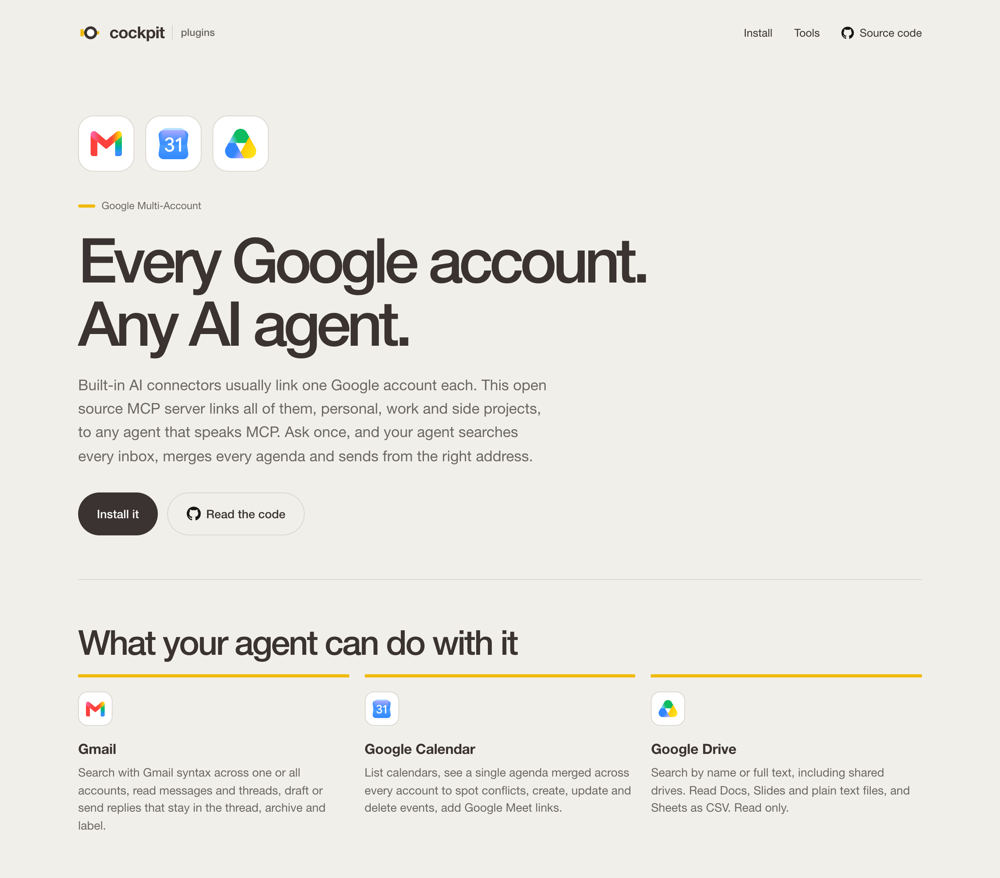

# Cockpit plugins

Source of [plugin.usecockpit.co](https://plugin.usecockpit.co), the marketplace of open source MCP servers built by [Cockpit](https://usecockpit.co).

[](https://plugin.usecockpit.co)

Each plugin is a [Model Context Protocol](https://modelcontextprotocol.io) server that connects your tools to the AI agent you already use. Plugins run on your own machine, with your own credentials, and never route your data through Cockpit servers.

## Plugins

| Plugin | What it does | Page | Source |
|---|---|---|---|
| Google Multi-Account | Connects several Gmail, Google Calendar and Google Drive accounts to your agent at once | [plugin.usecockpit.co/google-multi](https://plugin.usecockpit.co/google-multi/) | [dathims/google-multi-mcp](https://github.com/dathims/google-multi-mcp) |

## A tour of the marketplace

### One plugin, every compatible agent

Plugins run locally over stdio, so they work with Claude, Codex, Cursor, Gemini CLI, GitHub Copilot, Goose and any other MCP client. Each one also ships as a Docker image.



### A page per plugin

Every plugin has its own page: what the agent can do with it, how to install it, the tools it exposes and how it handles your data.

[](https://plugin.usecockpit.co/google-multi/)

## Pages

| Page | Purpose |
|---|---|
| `/` | Home page and list of plugins |
| `/google-multi/` | Google Multi-Account plugin (Gmail, Calendar, Drive, several accounts) |
| `/privacy/` | Privacy policy, compliant with the Google API Services User Data Policy (Limited Use) |
| `/terms/` | Terms of use and legal notice |

## Development

There is no build step: the site lives in `public/`.

Serve it locally on <http://localhost:4720>:

```bash
npm start
```

Check it before pushing:

```bash
npm run check
```

`npm run check` verifies the internal links and rejects long dashes (en and em dashes). GitHub Actions runs it on every push and every pull request.

## Adding a plugin

1. Create `public/<plugin>/index.html` by copying `public/google-multi/index.html`.
2. Add its card to the grid in `public/index.html`.
3. Add a row to the [Plugins](#plugins) and [Pages](#pages) tables above.
